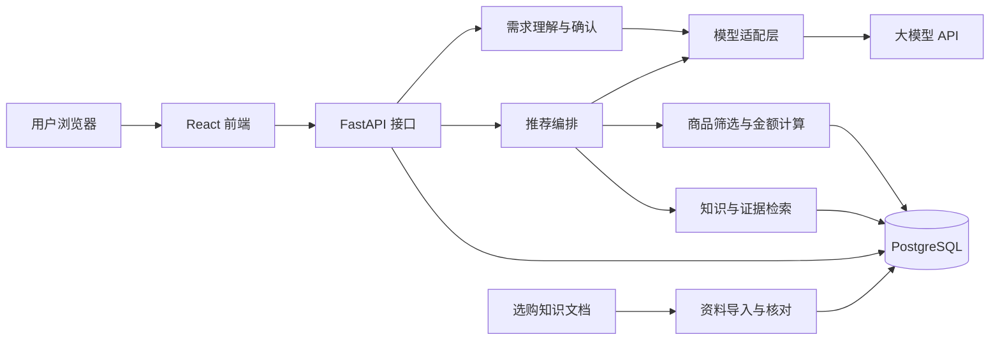

# AI 电子产品选购助手 · 技术设计文档

版本：v0.3  
日期：2026-10-02  
关联需求：[PRODUCT.md](./PRODUCT.md)  
项目目录：`D:\progects\电商导购`  
文档位置：`docs/TECHNICAL.md`  
状态：已交付本地演示工程；真实资料、模型调用与生产部署尚未完成。

## 1. 当前基线与决策状态

当前已有 React 前端、FastAPI 后端、12 个虚构商品版本、三篇编辑选购知识、本地 SQLite 数据库、Alembic 初始迁移、后端和浏览器测试，以及 Docker Compose 配置。启动方式见根目录 [README.md](../README.md)，实际验收见 [REPORT.md](../evaluations/REPORT.md)。

2026-10-02 补充独立采集器 `scripts/crawl_catalog.py`：小样本测试罗技中国官网两款具体版本，抽取 JSON-LD 身份与公开内嵌参数。草稿带出处、时间、页面哈希、字段定位及待审核状态；不写业务库。零价格占位、版本不匹配、未知属性和 404 不被转换成可推荐商品。完整采集/审核/导入链路仍未实现，见 [CRAWL_REPORT.md](../evaluations/CRAWL_REPORT.md)。

同日修复单品插图随卡片宽度溢出的布局问题，并把最新采集样本接入网站。页面默认「真实资料」，新增 `/api/v1/catalog/real-samples` 只读接口，展示真实 SKU、重量声明、来源和价格待补充状态。新需求字段 `catalog_mode=real/demo` 区分资料来源；旧 API 请求缺省为 demo，以兼容已有记录，但网页默认 real。真实需求当前持久化 `insufficient_evidence` 结果，不调用演示候选筛选或填入虚拟售价；切换「演示体验」才能查看虚拟型号与旧演示快照。此处 real 表示真实资料查看/完整性检查，尚不等于已审核真实推荐或模型能力。

**以下第 3～15 节保留完整技术蓝图，未特别标为已实现的内容仍属于目标，不能视为当前代码契约。** 演示基线实现了较小的五表模型、明确表单条件与有限关键词解析，不包含蓝图中的完整 claim/证据/报价体系或生产执行器。

### 1.1 已实现与边界

| 能力 | 当前实现 | 未完成部分 |
|---|---|---|
| 页面 | 需求表单、确认、最多三套方案、对比、知识/依据侧栏、响应式布局 | 正式品牌及用户调研 |
| 需求 | 目标/预算/用途/连接/声音/数字区；有限中文关键词与预算冲突提醒 | 任意自然语言理解、多轮语义合并、全部未知硬条件追问 |
| 推荐 | 精确整数金额、硬条件过滤、规则排序、组合差异、固定解释与取舍、无匹配 | 真实商品推荐与排序效果评测；独立 `insufficient_evidence` 判定 |
| 资料 | 虚构 demo JSON，未知声音保留 `null`；过期与非公开价格排除 | 真实 sources/claims/offers、审核发布、采集与更新 |
| 知识 | 三篇 Markdown 编辑规则可阅读 | 按需求检索、审核证据关联、向量检索 |
| 会话 | 24 小时 HttpOnly/SameSite Cookie、令牌哈希与归属校验、刷新恢复 | 清理过期数据、账号与跨设备访问 |
| 执行 | 先存任务再启动；202＋轮询；幂等键/输入哈希；单进程并发上限/超时/取消；重启中断转失败 | 心跳、任务领取锁、多进程限流、持久化 Worker；并发写需求的数据库级冲突保护 |
| 数据存储 | 五张 SQLAlchemy 业务表；SQLite 已运行，外键开启；结果和成功状态同事务提交 | PostgreSQL 实际连接和负载验证；独立历史报价与字段证据 |
| 模型 | `llm.py` 保留兼容聊天接口的适配草稿，未调用 | 供应商、格式与证据蕴含校验、调用日志、费用与超时评测；真实模式暂时拒绝启动 |
| 部署 | Nginx/API/PostgreSQL Compose，配置与离线 SQL 可检查 | Docker 引擎未启动，尚未构建镜像或启动 PostgreSQL；未上线 |

### 1.2 实际代码与接口

前端入口 `apps/web/src/App.tsx`，图示组件 `src/components/DeviceArt.tsx`，请求和类型 `src/lib/api.ts`。后端入口 `apps/api/app/main.py`，数据库模型 `db.py`，规则筛选与需求整理 `recommendation.py`，请求校验 `schemas.py`，配置 `core/config.py`。初始迁移位于 `migrations/versions/0001_initial.py`。

实际业务表为 `product_variants`、`anonymous_sessions`、`requirement_revisions`、`operation_runs`、`recommendation_snapshots`。商品参数与参考价暂存 JSON，仅适用于小规模演示。其他蓝图表尚未创建。

API 前缀为 `/api/v1`。异步提交直接返回 Run 对象，其 `id` 即运行标识；轮询返回 `output` 或 `result_id`，并非蓝图示例中的仅 `run_id` 包装。确认需求直接返回修订 `{id, needs}`。推荐结果为 `schemes` 数组，金额字段为 `total_minor`、`remaining_minor`。知识接口当前返回全部三篇知识；依据接口只支持 `demo:版本id`。

当前运行检查使用 Node.js 24.20.0、npm 11.19.0、Python 3.13.15；前端锁文件为 `package-lock.json`，后端通过独立 venv、`pyproject.toml` 和 `requirements.lock.txt` 固定本次解析依赖。PostgreSQL 容器配置选择 17 系列，实际运行尚未验证。

状态定义：

- **[已确认]**：用户接受的技术选型与产品方向。
- **[目标]**：第一版拟实现的技术设计，具体实现时可根据验证结果调整。
- **[后续]**：数据或业务增长后再引入的能力。
- **[待决策]**：模型供应商、运行版本、部署主机等尚未确定的事项。

第一版服务键盘、鼠标及键鼠组合的选购推荐。商城的账号、订单、支付、履约不纳入当前工程交付，但模块和商品标识为未来扩展保留边界。

## 2. 技术选型

| 层次 | 选择 | 状态 | 用途 |
|---|---|---|---|
| 前端 | React、TypeScript、Vite | [已确认] | 页面、组件、交互与构建 |
| 样式 | Tailwind CSS | [已确认] | 响应式布局、视觉变量与组件样式 |
| 后端 | Python、FastAPI | [已确认] | 业务接口、推荐编排、数据维护与模型调用 |
| 数据校验 | Pydantic | [已确认] | 请求、模型输出和导入资料的结构校验 |
| 数据库 | PostgreSQL | [已确认] | 商品版本、证据、价格、请求与结果快照 |
| 数据访问 | SQLAlchemy | [已确认] | 数据库查询、事务与实体关系 |
| 数据迁移 | Alembic | [已确认] | 表结构版本与增量迁移 |
| AI 服务 | 外部大模型 API | [已确认] | 需求提取、追问与有依据的解释 |
| 后端测试 | pytest | [已确认] | 筛选、金额、接口、校验与恢复流程 |
| 浏览器测试 | Playwright | [已确认] | 桌面与移动视口的完整用户流程 |
| 运行与部署 | Docker Compose | [已确认] | 统一前端服务、后端和数据库环境 |
| 初期知识检索 | 主题、标签与关键词检索 | [目标] | 检索少量审核后的选购知识 |
| 向量检索 | Embedding 服务＋pgvector | [后续] | 资料增长后增加语义检索 |

本地 Node/Python 与依赖已检查并锁定，详见 1.2。PostgreSQL 和容器环境还需要实际运行验证。

前端使用 npm，Python 使用标准 venv 与 pip；依赖声明与精确版本分开保存。容器构建与跨平台安装仍须实际复验。

## 3. 架构与职责

### 3.1 第一版架构

[目标] 采用前后端分离、单个后端服务的架构。后端内部按业务模块组织，资料整理脚本复用同一套数据校验和入库逻辑。



### 3.2 模块边界

| 模块 | 负责 | 对外提供 |
|---|---|---|
| `catalog` | 型号、版本、已核对参数和候选查询 | 查询符合硬条件的商品版本 |
| `pricing` | 渠道、参考价、适用条件与过期判断 | 可用参考报价、合计和价格提示 |
| `knowledge` | 选购文档、事实证据和相关检索 | 带出处与适用范围的资料包 |
| `requirements` | 需求提取、追问、修订与用户确认 | 版本化的结构化需求 |
| `recommendations` | 候选组合、排序、解释与最终校验 | 已校验的方案快照 |
| `llm` | 供应商适配、超时、输出校验和调用记录 | 统一的模型调用接口 |
| `sessions` | 匿名会话、请求归属与访问控制 | 会话内需求、任务与结果读取 |
| `runs` | 请求去重、状态与恢复 | 可查询的执行记录 |
| `ingestion` | 导入检查、待核对资料与发布 | 可追溯的数据发布结果 |

模型只能接收本次允许使用的资料，不获得写库、执行任意 SQL 或购买权限。商品筛选与金额计算通过明确的服务函数完成。

## 4. 工程目录与后续规划

已创建文档和业务分类目录。下面是长期目标结构；当前源码布局见 1.2，未列为已实现的模块子目录不一定存在：

```text
电商导购/
  README.md
  docs/
    PRODUCT.md
    TECHNICAL.md
  apps/
    web/
      src/
        app/                  页面入口与路由
        features/
          requirements/      输入、追问、确认与调整
          recommendations/   方案卡片与结果状态
          comparison/        方案对比
          evidence/          资料依据展示
        components/           共用组件
        lib/                  接口请求与工具函数
      tests/                  Playwright 用例
    api/
      app/
        main.py
        core/                 配置、日志与异常
        db/                   会话和数据库基础设施
        modules/              各业务模块
        llm/                  模型适配与提示词
      migrations/             Alembic 迁移
      tests/                  pytest 用例
      pyproject.toml
  data/
    demo/                     明确标注的演示资料
    curated/                  核对后的可导入商品资料
  knowledge/
    keyboards/                键盘选购知识
    mice/                     鼠标选购知识
  scripts/                    导入、复核和评测入口
  evaluations/                固定需求及人工核验记录
  infra/                      Compose、镜像与代理配置
```

演示数据与真实资料分开。抓取原文、临时文件、数据库备份、模型密钥和用户输入原文不默认提交到仓库。

## 5. 前端设计

### 5.1 页面组织

| 页面／区域 | 职责 | 数据来源 |
|---|---|---|
| 首页与需求输入 | 品类、预算、用途与补充描述 | 本地草稿与会话 |
| 需求确认 | 展示结构化需求、追问与冲突 | 需求分析结果 |
| 推荐结果 | 展示有效方案、价格与限制 | 已完成且校验通过的推荐快照 |
| 方案对比 | 按需求关注点比较候选 | 同一结果快照，不额外调用模型 |
| 依据面板 | 参数、证据摘要与来源 | 已允许访问的证据记录 |

优先用 React 本地状态与明确的接口请求实现当前流程。是否增加路由库和服务端状态管理库，在实际页面数量与请求复杂度明确后决定。

### 5.2 状态要求

- 输入草稿、确认后的需求、正在执行的请求与最近成功结果分别保存。
- 编辑预算等字段只修改草稿；主动提交后才产生新需求修订或推荐请求。
- 切换对比、展开依据和浏览历史快照均为读取行为。
- 新结果只有在完整校验并成功提交后才替换当前结果。
- 保留最近成功快照；失败、取消或新需求分析不能将其清空。
- 轮询只检查真实阶段状态，不生成虚构百分比。
- 刷新页面优先读取已有任务和结果，不重复发起模型调用。
- 请求返回时核对当前正在等待的任务标识与需求修订；旧请求的迟到结果只保留为快照，不覆盖新需求的可见结果。
- 当前会话的方案记录用于恢复操作；跨设备收藏、账号历史与公开分享为后续能力。

### 5.3 事实展示

型号、版本、参数、金额、来源链接及日期均由后端提供，前端负责呈现与格式化。币种与“参考价”标识固定展示，不能被模型文案改写。

移动端对比采用分组或可滚动表格，保留方案标题与总价识别。核心操作要有加载、禁用、错误和键盘焦点状态。

## 6. 数据模型与约束

### 6.1 基础约定

- 使用稳定标识关联型号、版本、价格与证据；名称不是主键。
- 金额以人民币分的整数表示，API 使用 `budget_minor`、`price_minor`、`total_minor`，如 500 元对应 50000 分。
- MVP 每件商品数量为 1；组合为一件键盘与一件鼠标。数量扩展后仍由后端计算。
- 时间使用带时区的时间戳，数据库按 UTC 记录，界面按用户时区格式化。
- 未知字段使用 `null` 或缺失状态；布尔字段的未知不能转换成 `false`。
- 所有金额、日期范围和状态转换由代码及数据库约束共同验证。

### 6.2 主要实体

| 实体 | 关键字段 | 约束／用途 |
|---|---|---|
| `products` | `id`、品类、品牌、型号、地区、状态 | 保存型号身份；同一地区型号去重 |
| `product_variants` | `id`、`product_id`、版本名称、结构化属性、资料修订、审核状态 | 同型号不同轴体／配置分别管理 |
| `sources` | `id`、类型、URL、地区、发布日期、采集时间、内容哈希 | 记录原始出处与资料版本 |
| `claims` | `id`、`variant_id`、字段或判断键、值、证据类型、适用条件、核对状态 | 描述参数事实或有限条件下的体验结论 |
| `claim_sources` | `claim_id`、`source_id`、必要证据摘要 | 允许一个结论关联多个来源 |
| `offers` | `id`、`variant_id`、渠道、购买链接、可售状态 | 对应真实版本与渠道；可售允许未知 |
| `price_observations` | `id`、`offer_id`、金额、币种、价格条件、记录时间、审核状态 | 价格更新追加记录，避免覆盖历史 |
| `knowledge_documents` | `id`、主题、品类、版本、内容哈希、来源、审核状态 | 对应维护的选购知识 |
| `knowledge_chunks` | `id`、文档版本、章节、内容、标签、适用范围 | 供检索与引用的最小资料片段 |
| `anonymous_sessions` | `id`、令牌哈希、创建时间、到期时间 | 匿名访问与结果归属 |
| `requirement_revisions` | `id`、会话、前一修订、结构化需求、确认状态 | 保留多轮变更，避免覆盖旧需求 |
| `operation_runs` | `id`、会话、类型、幂等键、输入哈希、需求修订、状态、阶段、期限 | 跟踪分析与推荐执行 |
| `recommendation_snapshots` | `id`、请求、需求快照、资料版本、方案与证据、生成时间 | 保存不可变的成功结果 |
| `llm_calls` | 请求、阶段、模型、提示词版本、用量、耗时、结果状态 | 调试与成本观测，不默认记录原文 |

### 6.3 属性与证据

`product_variants` 保存可检索属性，按品类使用不同 Pydantic 模型校验，再存入 JSONB 或常用字段。常用于硬筛选的字段应根据查询需要建索引，不能将所有数据只存成无法校验的描述文本。

属性与有效 `claim` 关联。审核发布时同步更新属性投影，确保用于查询的值与证据对应。冲突字段保持待核对状态，退出涉及该字段的确定匹配。

证据类别至少区分：厂商参数、渠道信息、明确条件的测量、体验观察与选购规则。不能把厂商宣传转换成独立测量结果。

### 6.4 事务与快照

- 资料发布、需求修订和推荐结果写入分别使用短事务。
- 模型网络调用不占用数据库事务或锁；调用前读取候选与资料快照。
- 生成完成后检查所用资料是否仍允许展示。价格过期或关键事实被撤销时，阻止按原状态发布预算内方案。
- 资料更新采用修订与追加记录；快照保留本次实际使用的值和证据版本。
- 推荐结果写入与任务成功状态在同一事务提交，避免出现“成功但无结果”。

SQLAlchemy 提供事务管理能力；事务边界仍需要按业务设计。[官方说明](https://docs.sqlalchemy.org/en/20/orm/session_transaction.html)

## 7. 商品资料与知识库构建

### 7.1 商品导入

第一版采用经核对的 JSON 或 CSV 导入。JSON 作为规范化交换格式，CSV 作为便于人工整理的入口，转换后使用同一校验模型。

导入步骤：读取资料 → 校验结构与单位 → 检查身份和版本 → 关联来源 → 标记缺失／冲突 → 人工核对 → 事务发布。

- 同一资料重复导入应可识别，不重复创建商品或证据。
- 用来源标识、内容哈希与导入批次追踪变化。
- 单行错误明确定位，不静默丢失数据或补造字段。
- 关键参数更新前校验对应版本，价格更新追加观察记录。
- 自动采集资料进入待核对区，不直接覆盖已发布资料。
- P0 通过脚本维护资料；可视化后台在后续补充。

### 7.2 价格可用性

报价有效条件：审核通过、人民币、对应版本正确、公开价格条件清楚、金额为正、未超过复核阈值，且渠道未被明确标记为停售。

初始 `PRICE_MAX_AGE_DAYS` 建议为 7，属于可调整的维护策略。该规则不会把参考价变成实时价格。

同版本有多个报价时，先保留各自来源，按有效公开报价选择计算用记录；渠道选择策略写入规则版本。缺价或过期商品可用于解释资料不足，不能进入确定预算内的方案。

组合只计算已明确的商品参考价。运费未知或优惠条件未核对时，响应中明确列为未计入项。

### 7.3 选购知识文档

每篇 Markdown 围绕一个主题，例如数字区、连接方式、宿舍噪声或鼠标握持。需要维护：文档标识、品类、标签、适用条件、来源、复核时间和版本。

按标题与内容主题分段，保留标题路径和文档版本；不把不同测试条件和不同产品版本混在一个可引用结论中。

导入 PostgreSQL 后，运行时检索数据库中的已审核资料。Markdown 为维护源，数据库为发布后的可检索版本；内容哈希用于识别变更，避免两套内容无规则地分别修改。

### 7.4 初期检索

1. 从需求中提取品类与关注主题。
2. 先找候选版本对应的有效事实证据。
3. 再按主题、标签与关键词匹配相关选购知识。
4. 对匹配结果去重，限制资料数量与长度。
5. 返回文段标识、出处、适用条件与资料版本。

第一版中文资料优先使用人工标签、关键词词表与简单匹配。不能假设 PostgreSQL 默认全文检索配置已经解决中文分词。

### 7.5 后续语义检索

资料增多且关键词召回不足后，再引入 Embedding 与 pgvector。保留“结构化筛选 → 限定品类和版本 → 语义检索 → 证据校验”的顺序。

记录向量模型、维度、文本哈希与索引版本；更换向量模型时重建相应向量，避免混用不可比的结果。检索上线前对照固定需求检验召回与最终解释质量。[pgvector 官方文档](https://github.com/pgvector/pgvector)

## 8. AI 与推荐流程

### 8.1 结构化需求

需求模型包括：目标品类、人民币预算、主要用途及优先级、硬要求、偏好、未知项与冲突项。

每个条件记录稳定标识、适用品类、字段或判断、目标值、要求强度及用户表达的来源位置。

- 组合需求可分别约束键盘和鼠标。
- 表单预算是明确输入；与自然语言预算冲突时返回待确认项。
- 新修订从上一确认版本应用明确变更，不丢失其余条件。
- 未解析的新要求保留为待确认项，不能静默忽略后声称全条件匹配。
- 预算、品类和用途缺失或关键条件冲突时，先补充需求再执行推荐。

### 8.2 模型适配层

统一提供 `analyze_requirements` 与 `explain_recommendations` 两类调用，供应商 SDK 或 HTTP 实现在适配层中封装。

适配层负责：配置、请求超时、取消信号、返回格式、用量记录、供应商错误映射以及结构校验。

供应商支持结构化输出时优先使用；仍执行本地校验。供应商不支持时，通过明确 JSON 契约输出，解析失败后执行有限纠正或返回错误，不靠正则猜出缺失业务事实。

Pydantic 对金额整数、枚举和关键布尔字段采用明确约束或严格校验，关键模型拒绝契约外字段；格式合规不代表商品事实正确。[严格模式说明](https://docs.pydantic.dev/latest/concepts/strict_mode/)

### 8.3 候选筛选与组合

推荐由后端选择候选，模型不自行添加产品。

1. 获取有效商品版本、属性证据与报价。
2. 过滤品类、系统兼容和明确硬要求。
3. 硬要求依赖未知或冲突资料时，不把该候选计为符合条件。
4. 单品按预算筛选；组合枚举符合条件的键盘与鼠标配对，计算合计。
5. 按用途相关性、偏好满足情况、证据完整性与价格等规则排序。
6. 对方案去重，保留最多 3 套实际有差异的方案。

初期商品数量较小，组合可以在限制后的候选集中进行确定性计算。随着数据增多再优化候选上限与查询，不静默截断导致误报无匹配。

规则记录版本。用途标签和偏好匹配必须能追溯到字段、证据或明确规则；权重和方案多样性策略通过评测调整，不展示未经定义的用户评分。

### 8.4 解释输入与输出

模型输入仅包含确认需求、后端选定方案、所用参数与价格快照、允许引用的证据以及相关选购知识。

输出包含方案标识、匹配条件标识、理由、取舍、证据标识与不确定项。型号、参数表、报价、合计及购买链接由后端组装，不由模型自由生成。

对可核实的核心结论，优先让模型选择已核对的 `claim` 与需求匹配关系，再由后端形成事实展示。模型不得把选购规则推断成商品实测。

### 8.5 最终校验

校验至少覆盖：

- 所有方案、版本和报价来自本次后端候选。
- 金额按分计算并满足确认预算，组合品类和数量正确。
- 每个硬要求有有效字段或证据支持。
- 引用来自本次实际提供的文段或结论，且适用版本和条件正确。
- 用于发布的报价与关键证据未过期或被撤销。
- 没有添加库外产品、重复方案或自动放宽条件。

“引用存在”不等于“引用能证明这句话”。核心事实使用受控字段和已审核结论展示；自由解释的语义质量需要固定评测与人工核验，不能仅凭 JSON 校验宣称完全正确。

无有效候选时由后端返回 `no_match` 或 `insufficient_evidence`，无需让模型编造替代方案。调整建议不修改用户条件，需用户主动确认后重新执行。

## 9. 接口契约

### 9.1 公共规则

- API 前缀：`/api/v1`，使用 JSON。
- 价格按分返回，时间为带时区的 ISO 8601 字符串。
- 公共错误结构包含 `code`、安全的 `message`、`request_id` 和是否可由用户重试。
- Cookie 确定匿名会话身份；路径中的会话或结果标识不代表访问权限。
- 创建分析与推荐的 POST 请求必须携带 `Idempotency-Key`。
- `202 Accepted` 表示执行记录已创建或同一任务仍在执行，不表示推荐成功。
- GET、轮询、对比与资料查看不触发模型调用。

### 9.2 接口列表

| 方法与路径 | 作用 | 核心行为 |
|---|---|---|
| `POST /sessions` | 创建或恢复当前匿名会话 | 设置会话 Cookie，返回标识与到期时间 |
| `GET /sessions/{session_id}` | 恢复当前状态 | 返回需求修订、运行任务与最近成功结果 |
| `POST /sessions/{session_id}/analyses` | 分析初始或调整需求 | 创建 `analysis` 任务，返回 202 和 `run_id` |
| `POST /sessions/{session_id}/requirements` | 提交用户确认的需求修订 | 校验基础修订和必填条件，返回新的确认版本 |
| `POST /sessions/{session_id}/recommendations` | 执行推荐 | 引用确认的需求修订，创建任务并返回 202 |
| `GET /sessions/{session_id}/runs/{run_id}` | 查询执行状态 | 返回状态、真实阶段、产物标识或错误 |
| `POST /sessions/{session_id}/runs/{run_id}/cancel` | 请求停止当前执行 | 标记取消请求，安全阶段停止 |
| `GET /sessions/{session_id}/results/{result_id}` | 读取结果快照 | 返回方案、需求、证据及价格提示 |
| `GET /products/{product_id}` | 查看公开商品资料 | 只返回发布后允许展示的数据 |
| `GET /evidence/{evidence_id}` | 查看公开证据 | 返回摘要、出处与适用范围 |
| `GET /health/live` | 进程健康 | 不调用模型 |
| `GET /health/ready` | 服务准备状态 | 检查必要配置和数据库，不产生付费请求 |

需求确认属于结构校验和修订操作，不自动执行推荐。前端“查看推荐”提交推荐请求；用户无需理解内部接口步骤。

### 9.3 请求示例

以下为拟定契约，标识用于说明，不代表已有接口或真实数据。

```json
{
  "structured_input": {
    "target": "keyboard_mouse_bundle",
    "budget_minor": 50000,
    "currency": "CNY",
    "primary_use": "coding"
  },
  "text": "宿舍用，偶尔游戏，希望安静一点",
  "base_requirement_revision_id": null
}
```

分析完成后返回草稿、待确认项和最多 1～2 个当前必要问题。推荐完成后的业务结果类型为 `matched`、`no_match` 或 `insufficient_evidence`；服务或格式失败使用任务错误状态，不能混淆为正常无匹配。

### 9.4 状态码

| 状态码 | 场景 |
|---|---|
| 200／201 | 成功读取／创建会话或需求修订 |
| 202 | 分析或推荐任务已接受 |
| 401 | 会话令牌无效或过期 |
| 404 | 资源不存在或不属于当前会话 |
| 409 | 幂等键对应不同内容、基础修订已变化或会话存在冲突任务 |
| 422 | 输入格式不符、需求尚有关键缺失或冲突 |
| 429 | 超出会话、访问频率或全局执行限制 |
| 503 | 服务尚未准备好，当前无法接受执行 |

任务接受后发生的模型超时、格式错误与执行中断通过任务查询返回错误码，如 `MODEL_TIMEOUT`、`MODEL_OUTPUT_INVALID`、`RUN_INTERRUPTED`，而不是把轮询 HTTP 响应本身作为推荐成功依据。

## 10. 执行状态、去重与恢复

### 10.1 状态设计

任务状态：`queued → running → succeeded / failed / cancelled`。到期任务通过清理流程退出可访问范围，保留必要的匿名诊断信息。

分析任务的成功产物为需求草稿及问题；推荐任务的成功产物为匹配方案或可解释的无匹配／证据不足结果。`succeeded` 不意味着一定推荐到商品。

阶段字段仅记录实际执行中的步骤，例如解析需求、筛选商品、检索依据、生成解释和最终校验。

### 10.2 幂等性与并发

- 数据库唯一约束：会话＋幂等键；保存规范化请求内容的哈希。
- 同键同内容返回已有任务；同键不同内容返回 409。
- 前端同一次提交在网络重试中沿用同一幂等键。
- 用户主动改变需求或在已失败后重新尝试，创建新键并关联前一次任务。
- 第一版每会话同时最多一个影响当前需求的执行任务；全局并发设可配置上限。
- 执行任务通过事务中的状态条件更新领取，避免重复启动。

幂等键控制本站请求重复，不能保证外部模型服务只计费一次。供应商超时但可能已执行时，记录结果不确定，不无限重发请求。

### 10.3 初期执行方式

[目标] 低并发 MVP 使用单个 API 进程内的受控执行器处理已持久化任务；并发、期限、状态和心跳写入数据库。创建任务与实际启动分开，启动前必须先完成持久化。

可使用 FastAPI 的后台任务机制启动有限流程，但它不是持久化任务队列，不能单独提供重启恢复保证。[后台任务说明](https://fastapi.tiangolo.com/tutorial/background-tasks/)

第一版只部署一个执行进程，并禁止通过增加多个进程绕过并发限制。启动时及周期检查超期未完成任务，将确已中断的任务标记失败；已发出的模型调用结果不明确时不自动重新计费执行。

若需要多实例、高可用或大量采集任务，在上线前升级为独立 Worker 和持久化队列，继续复用任务标识、幂等约束与结果快照。

### 10.4 超时、重试与取消

- 设置连接、单次模型调用和整体任务的截止时间；具体值通过试跑确定并配置。
- 同一任务最多允许一次受控恢复尝试，并受整体时间与调用预算限制。
- 明确可恢复的限流／暂时故障可退避重试；结果不确定的网络超时不直接重复调用。
- 格式错误最多一次纠正；仍失败则终止，绝不靠补造参数通过校验。
- 取消先记录信号，后续步骤检查信号并停止。已发到供应商的请求可能已产生费用，不能保证撤销。
- 任务期限耗尽后退出执行状态；前端读到明确错误，不无限轮询。
- 浏览器关闭不等同于取消；刷新按任务标识恢复，不新建执行。
- 失败不覆盖最近成功结果，重试由用户主动触发。

## 11. 会话、配置与运行边界

### 11.1 匿名会话

[目标] 第一版不要求登录。使用随机会话令牌与服务端归属校验，Cookie 设为 HttpOnly、合适的 SameSite，生产 HTTPS 环境开启 Secure。数据库保存令牌哈希。

所有会话私有接口验证资源归属；UUID 难猜不能替代访问控制。写入接口检查来源与必要的请求保护，CORS 使用明确的开发或生产来源。

[建议／待决策] 匿名需求与结果先按 24 小时临时保留，配置到期清理。上线前确定并在界面说明；原始自然语言只在必要范围内临时存储，不作为永久聊天历史默认保留。

### 11.2 配置项

拟通过环境变量管理以下配置，示例文件只包含键名与安全说明，不写真实凭据：

| 配置 | 用途 |
|---|---|
| `APP_ENV`、`DATABASE_URL` | 环境与数据库连接 |
| `ALLOWED_ORIGINS` | 允许访问的前端来源 |
| `LLM_PROVIDER`、`LLM_MODEL`、`LLM_API_KEY` | 模型供应商与服务凭据 |
| `LLM_BASE_URL` | 服务端配置的供应商地址，不能由用户输入决定 |
| `LLM_TIMEOUT_SECONDS`、`RUN_TIMEOUT_SECONDS` | 调用与整体执行期限 |
| `MAX_CONCURRENT_RUNS` | 全局执行上限 |
| `PRICE_MAX_AGE_DAYS` | 报价复核阈值 |
| `SESSION_TTL_HOURS` | 匿名会话保留期限 |
| `MAX_INPUT_CHARS`、`MAX_CONTEXT_TOKENS` | 用户输入与资料上下文上限 |
| `DEMO_MODE` | 明确切换演示与真实服务模式 |

密钥只在后端使用，不进入前端 `VITE_*` 变量或浏览器代码。没有模型配置时可明确运行演示模式，不能静默用模拟结果冒充真实推荐。

### 11.3 日志与模型边界

- 记录请求标识、阶段、规则与提示词版本、候选数量、用量和错误类型。
- 有实际价格配置才能计算模型费用；只知道 token 数时记录用量，不伪造金额。
- 不默认记录完整输入、完整提示词、密钥或数据库连接串。
- 用户输入与资料文段作为数据处理，不能改变系统约束、调用地址或允许引用集合。
- 模型调用和数据库查询有输入、长度与时间限制，禁止无限循环生成。

## 12. 开发、部署与迁移

### 12.1 本地开发目标

前端开发服务、FastAPI 和 PostgreSQL 分别运行。Vite 将 `/api` 代理到后端，减少本地跨域差异；实际端口在初始化时统一配置并写入 README。

PostgreSQL 可通过 Compose 运行；先核对本机 Docker、Node.js 和 Python 可用性。启动本地服务不能作为上线完成的证据。

### 12.2 部署目标

Compose 规划 `web`、`api`、`db` 三个服务：

- `web` 提供 React 构建后的静态文件，并将 `/api` 代理到 `api`。
- `api` 运行 FastAPI 和初期受控执行器。
- `db` 使用持久化卷保存 PostgreSQL 数据，不对公网开放数据库端口。

通过同源域名提供页面与 API，公开环境配置 HTTPS。生产 SPA 代理要支持页面直接刷新，并正确传递请求标识与超时设置。具体主机、域名、代理软件和 TLS 配置为待决策。

Compose 用于定义和运行多容器应用；是否需要更高可用的部署方案由实际需求决定。[官方文档](https://docs.docker.com/compose/)

### 12.3 迁移、备份与发布

- 表结构变更以 Alembic 迁移提交，应用启动不自动修改生产表。
- 迁移作为显式部署步骤；执行前备份并核对代码与数据库版本。
- 破坏性变更采用先兼容、再迁移、后清理的方式；数据恢复不能只依赖迁移回退。
- 商品发布记录数据批次与资料版本，演示批次不混入真实推荐。
- 备份包含商品资料和已发布知识；按保留策略处理匿名会话，验证恢复能力。
- 发布后核验页面、接口、数据、实际模型链路与关键异常；不因容器启动就宣称完成部署。

## 13. 测试与评测

### 13.1 测试层次

| 层次 | 工具／方式 | 重点 |
|---|---|---|
| 数据与业务规则 | pytest | 金额边界、未知值、版本、证据与硬条件 |
| 数据库集成 | pytest＋测试 PostgreSQL | 唯一约束、事务、导入幂等、快照与权限 |
| 模型契约 | 固定替身输出 | 非法 JSON、缺字段、库外产品、无效引用与超时 |
| 接口流程 | FastAPI 测试客户端 | 会话、需求修订、任务状态与去重 |
| 浏览器流程 | Playwright | 输入、追问、结果、对比、调整、刷新与失败恢复 |
| 真实模型评测 | 固定需求＋人工核验 | 提取准确性、解释依据、无匹配和多轮一致性 |

pytest 和 Playwright 分别用于代码测试与浏览器自动化；实际质量以业务用例和观察结果为准。[pytest 文档](https://docs.pytest.org/en/stable/)、[Playwright 文档](https://playwright.dev/docs/intro)

### 13.2 必测规则

- 预算 50000 分时，合计等于预算可通过，多 1 分应拒绝。
- 缺失布尔参数不视为已知；不满足或无法确认硬要求的候选退出匹配。
- 同型号不同轴体不得共享不适用的参数、价格或体验证据。
- 过期价、条件价和明确停售渠道不参与确定预算内推荐。
- 一套匹配只返回一套，无匹配不调用模型补造商品。
- 引用存在但版本不适用时仍应拒绝；重点结论的支撑关系需人工评测。
- 幂等键并发提交只创建一条执行记录；同键不同内容返回冲突。
- 模型返回后不能覆盖新的需求修订；结果绑定自己的需求快照。
- 数据发布改变关键事实时，执行中的旧候选不能绕过最终有效性检查。
- 服务中断后任务进入可解释失败状态；刷新不重复调用，旧成功结果仍可读。
- 非当前会话不能读取、取消或修改其他会话的任务与结果。

### 13.3 与产品验收的对应

`PRODUCT.md` 的 AC-01～AC-16 是交付验收基础。金额、版本和条件规则使用后端测试；AC-07、AC-13、AC-15、AC-16 等同时需要浏览器流程验证；AC-06、AC-11、AC-14 等需要模型契约测试和真实解释核验。

初期准备至少 20 条固定需求，记录资料批次、规则、模型与提示词版本、结果和人工判定。外部模型测试由显式入口执行；常规测试使用替身，避免意外付费与外部服务波动。

前端类型检查与生产构建、后端业务和接口测试、数据库迁移验证、关键浏览器用例均通过后，再进行真实服务试跑。所有结果如实记录，文档创建不等于测试通过。

## 14. 实现顺序与长期演进

| 阶段 | 具体工作 | 完成边界 |
|---|---|---|
| M0 | 技术契约、字段规范、资料样本与基础工程 | 能检查配置、运行服务和导入核对后的样本 |
| M1 | 输入、确认、结果、对比与调整前端 | 使用明确演示资料走通交互 |
| M2 | PostgreSQL、数据导入、筛选与金额计算 | 不依赖模型也能检验候选与预算规则 |
| M3 | 模型适配、需求分析、解释、校验与任务恢复 | 真实 AI 结果绑定实际资料并可追溯 |
| M4 | 评测、浏览器验收、部署与运行说明 | 产品 P0 与 AC 用例完成，限制明确 |
| 后续 A | 自动采集、管理后台、语义检索与资料变化监控 | 先验证更新质量和检索效果 |
| 后续 B | 独立 Worker、队列与共享限流 | 满足多进程、并发增长和恢复需求 |
| 后续 C | 收藏、分享、账号与扩品类 | 新增访问权限、资料字段与验证场景 |
| 后续 D | 商城交易模块 | 建立订单、支付、库存与履约的独立业务契约 |

商城扩展时保留稳定 `product_id` 和 `variant_id`，增加商城销售 SKU、销售价格和库存记录。渠道参考报价继续作为导购资料，不能直接充当成交价。支付回调、订单幂等、库存并发与退款需要另行设计和验收。

## 15. 待决策事项

| 决策 | 当前方向 | 确定时点 |
|---|---|---|
| 运行时与依赖精确版本 | 本地已检查并锁定，容器兼容性待验证 | 容器运行 |
| Python 环境与锁定工具 | 已采用 venv/pip、`pyproject.toml`＋`requirements.lock.txt` | 当前基线已确定 |
| 大模型供应商与模型 | 中文需求理解、可校验输出、预算合适 | 真实模型接入 |
| 外部调用 SDK、超时和恢复策略参数 | 统一适配层与有限调用预算 | 小样本试跑 |
| 商品属性的具体列与索引 | 常用硬筛选字段优先 | 数据模型迁移 |
| 排序权重与多样性策略 | 依据首轮固定评测调整 | 推荐调试 |
| 匿名资料保留期限 | 建议 24 小时，可配置并向用户说明 | 面向用户运行前 |
| 初期执行器实现 | 单进程、数据库状态与中断恢复 | 任务模块实现 |
| 资料采集渠道与复核责任 | 少量可信来源，7 天价格复核阈值待验证 | 真实资料维护 |
| 生产主机、域名与代理 | 同源前后端、HTTPS、数据库内网 | 部署准备 |
| 向量模型与索引方案 | 关键词不足时引入 | 语义检索阶段 |

## 16. 文档维护与完成定义

- 实现后更新当前基线，注明实际存在的目录、配置、接口与部署状态。
- 设计改变时同步相关数据模型、API 契约和产品规则，不只修改代码。
- 已确认技术选型与尚未实现的功能分别记录。
- 不将规划中的向量检索、爬虫、商城或高可用写成已完成能力。
- 当前交付含本地演示代码与验证记录；真实资料、模型服务、生产验证和上线待后续执行。

| 版本 | 日期 | 内容 |
|---|---|---|
| v0.1 | 2026-10-02 | 根据已确认选型建立模块、数据、接口、推荐、检索、执行恢复、测试、部署与长期扩展方案 |
| v0.2 | 2026-10-02 | 文档移入 `docs/`，更新实际分类目录与尚未创建的工程子目录说明 |
| v0.3 | 2026-10-02 | 增加本地演示基线、实际五表模型与 API 契约，明确蓝图、真实资料、模型和部署边界 |
